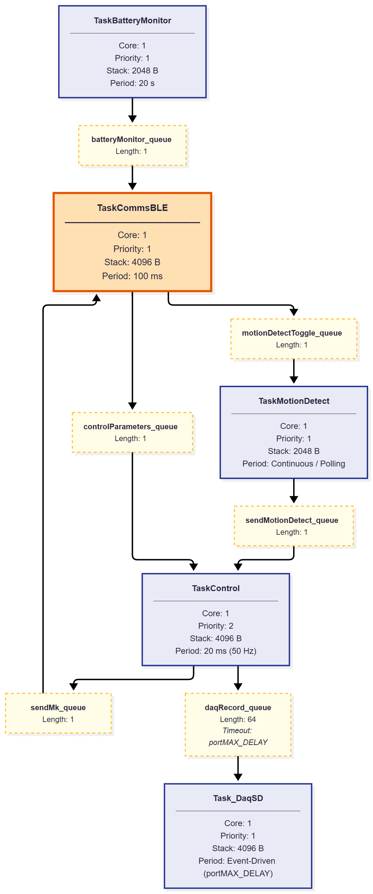
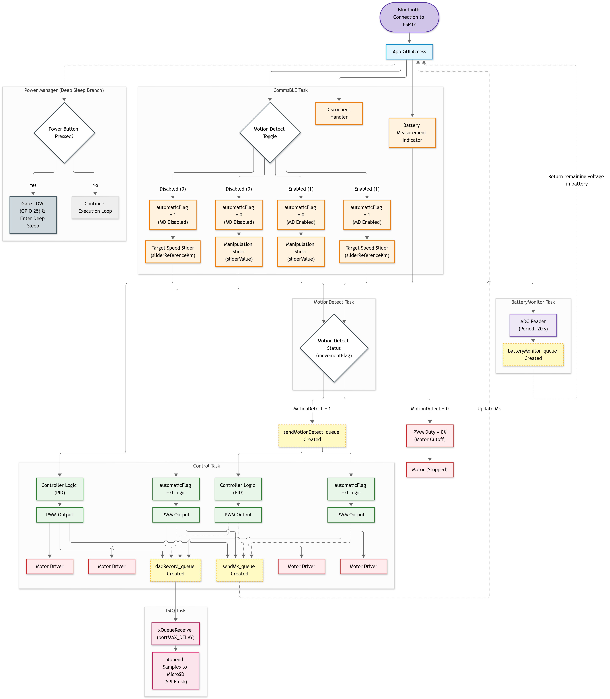
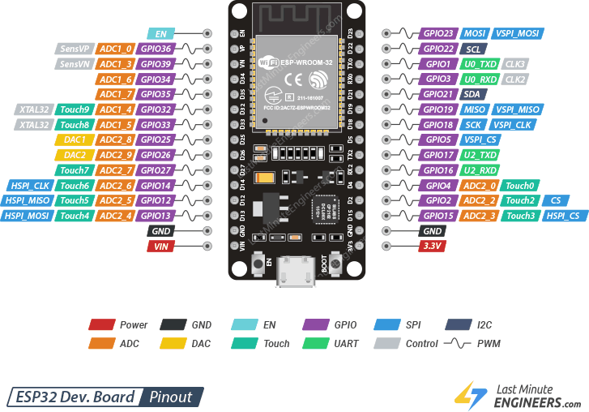
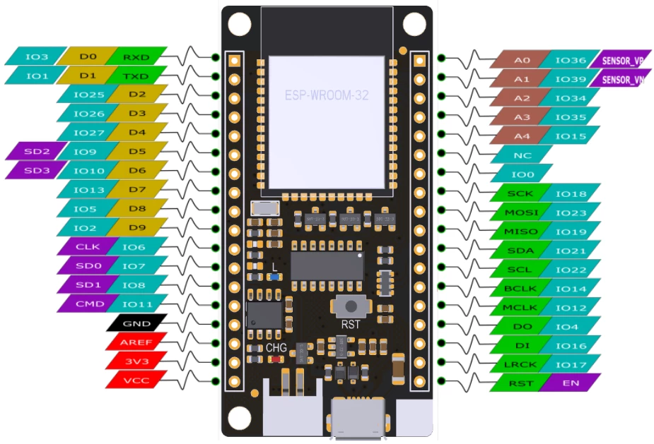

# Variables
## Created variables for Control.cpp file
* `static int velocityPerKm` $\rightarrow$ Stores the measured speed.
  * Brang it from MotionDetect task.
* `int sliderValue` $\rightarrow$ Stores the calculated manipulation from the PID.
  * Needed to be send to the BLE task so the manipulation slider shows its value.
* `double sliderReferenceKm` $\rightarrow$ Stores the desired speed set by the user in the app.
  * Brang it from the BLE task.
* `movementFlag` $\rightarrow$ Shows if the bike is moving by comparing if rpm > rpmThreshold

### CommsBle.cpp
* `automaticFlag` $\rightarrow$ Changes based on the Automatic selection in the app.
### Control.cpp
* `pidFlag` $\rightarrow$ If automaticFlag is turned on and speed is different from zero, then pidFlag turns on.

# Inputs/Outputs of each task 
## 1. CommsBLE
  ### Inputs
  1. Battery level $\leftarrow$ Battery Monitor
  ### Outputs
  1. Motion Detect Toggle $\rightarrow$ MotionDetect
  2. Open Loop Slider $\rightarrow$ Control
  3. Close Loop Slider $\rightarrow$ Control
  4. adaptationMode Flag $\rightarrow$ Control
  5. automaticFlag $\rightarrow$ Control
  6. pidFlag $\rightarrow$ Control

## 2. Control
  ### Inputs
  1. Open/Close loop selection $\leftarrow$ CommsBLE
  2. Schmhitt Trigger Flag (movement allowed or not) $\leftarrow$ MotionDetect
  ### Outputs
  1. Manipulation $\rightarrow$ CommsBLE task

## 3. MotionDetect
  ### Inputs
  1. Motion Detect Toggle $\leftarrow$ CommsBLE
  ### Outputs
  1. Flag to notice Scmhitt Trigger has allowed movement $\rightarrow$ Control
  2. Timer of inactivity

## 4. PowerManagement
  ### Inputs
  ### Outputs
  1. Thermistor sensor read ******

## 5. BatteryMonitor
  ### Inputs
  ### Outputs
  1. Value of the remaining battery level. $\rightarrow$ CommBle
  2. Flag that indicates when low battery is remainding. $\rightarrow$ Control task

# Flow and details of every task

# Flowchart

# Pinouts
It is important to mention that even if a Firebeetle looks like an entire different board, it continues using an ESP32 chip, that is why the GPIO ports are able to accomplish the same tasks. The only difference is that the GPIO ports from the ESP32 Dev. Board are located in totally different places than the Firebeetle ones.
## ESP32 Dev. Board Pinout

## Firebeetle Pinout

### Used GPIO pins

| Pin (GPIO) | Name | Description | Type | Considerations |
| --- | --- | --- | --- | --- |
| **GPIO 2** | `LED_PIN` | Onboard status LED | Digital Output | Strapping pin; keep LOW or floating during boot.|
| **GPIO 4** | `PWM_PIN` | PWM modulation signal to motor driver/VESC | PWM Output (LEDC) | Strapping pin (weak internal pull-down at boot).|
| **GPIO 5** | `POWER_STAGE_PIN` | Vedder Switch gate enable/cutoff | Digital Output / RTCIO6 | Turns off antispark switch during Deep Sleep.|
| **GPIO 12** | `JTAG_TDI` | Test Data In (ESP-Prog) | JTAG Input / Strapping | **Critical:** Do not add an external pull-up (prevents 1.8V Flash selection).|
| **GPIO 13** | `JTAG_TCK` | JTAG Test Clock (ESP-Prog) | JTAG Input | Debugger |
| **GPIO 14** | `JTAG_TMS` | Test Mode Select (ESP-Prog) | JTAG Input | Debugger |
| **GPIO 15** | `JTAG_TDO` | Test Data Out (ESP-Prog) | JTAG Output | Debugger |
| **GPIO 18** | `SD_SPI_SCK` | SPI Bus Serial Clock | SPI Output (Native VSPI) | MicroSD card module.|
| **GPIO 19** | `SD_SPI_MISO` | Master In Slave Out data line | SPI Input (Native VSPI) | MicroSD card module.|
| **GPIO 23** | `SD_SPI_MOSI` | Master Out Slave In data line | SPI Output (Native VSPI) | MicroSD card module.|
| **GPIO 25** | `BATTERY_READ_FLAG` | Voltage divider MOSFET activation | Digital Output | Closes the divider circuit only during measurement. |
| **GPIO 26** | `ON_OFF_BUTTON_PIN` | System power/sleep push-button | Digital Input / RTCIO7 | Push button wake/sleep control.|
| **GPIO 27** | `SD_SPI_CS` | MicroSD Chip Select (`CS`) | Digital Output (SPI CS) | Toggles SPI communication with the SD card.|
| **GPIO 34** | `BATTERY_PIN` | Battery voltage reading after divider | Analog Input (ADC1_CH6) | Reads the voltage from the voltage divider.|
| **GPIO 35** | `HALL_SENSOR_U_PIN` | Phase U Hall sensor pulse capture | Digital Input (Input-Only) | Requires an external 5 kΩ pull-up resistor tied to 3.3V. |
| **GPIO 36** | `HALL_SENSOR_V_PIN` | Phase V Hall sensor pulse capture (SENSOR_VP) | Digital Input (Input-Only) | Requires an external 5 kΩ pull-up resistor tied to 3.3V.|
| **GPIO 39** | `HALL_SENSOR_W_PIN` | Phase W Hall sensor pulse capture (SENSOR_VN) | Digital Input (Input-Only) | Requires an external 5 kΩ pull-up resistor tied to 3.3V. |

---

### Available GPIO Pins

| Pin (GPIO) | Description |
| --- | --- |
| **GPIO 21** | Digital GPIO Input/Output, Interrupts |
| **GPIO 22** | Digital GPIO Input/Output, Interrupts |
| **GPIO 17** | Digital GPIO Input/Output |
| **GPIO 32** | Digital GPIO In/Out, RTCIO9, ADC1_CH4 | 
| **GPIO 33** | Digital GPIO In/Out, RTCIO8, ADC1_CH5 |
| **GPIO 0** | GPIO In/Out, Strapping pin, RTCIO11 | 
| **GPIO 1 & 3** | UART0 (`TX0` and `RX0`) | 
| **GPIO 6 to 11** | Internal SPI Flash Bus **Restricted:** Do not connect external wiring; causes immediate crash or *bootloop*. | 

# Battery ADC Math
Since ESP32 ADC pins are able to measure maximun 3.3V, the selected procedure to get the remaining voltage in the battery was a regular "Voltage Divider".

Brief math explanation behind battery level calculation:
$$
V_{pin} = V_{battery}*\frac{R1}{R1+R2}
$$

where $R1 = 10 K\Omega$ and $R2 = 100K\Omega$

$$
V_{pin} = V_{battery}*\frac{10K\Omega}{10K\Omega + 100K\Omega},
$$

$$
V_{pin} = V_{battery}*\frac{1}{11},
$$

$$
V_{battery} = V_{pin}*11
$$

## Notas para mí
* Traer valores de bluetooth mediante un string si es que no habrá race conditon.

* Una función de RTOS `void Function(void *pvParameters)` jamás debe tener un return, puede usar funciones auxiliares que tengan un return y guardar ese valor en alguna variable que luego será mandada por medio de una queue

* ¿Dónde realizo la asignación de pines (PINMODE)?
  * La respuesta a esto es que ponerla en esta posición me permitirá correrla UNA sola vez y que no se repita dentro de la task.

        BaseType_t BatteryTask_Init(void) 
        {
          adc_init(); -> Se ejecuta UNA sola vez antes de la creación
          
          return xTaskCreate(
              BatteryTask_Loop,
              "TaskBattery",
              2048,
              NULL,
              1,
              NULL
          );
        };

* Voltaje máximo de batería = 25.2V, max 4.2V por celda.

## Cosas que podríamos cambiar
* Regresar el divisor de voltaje a 3.3 volts y usar la API analogReadMilliVolts(), que en lugar de usar un ADC normal, utiliza una lookup table para hacer la conversión lineal todo el tiempo

## Pendiente
* En mi tarea de control, si mi esp está desconectada de bluetooth o si acabo de conectarla, enviar manipulación 0
